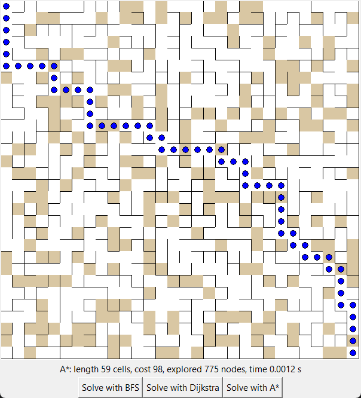

# Maze Generator and Solver

A Tkinter app that generates a random grid maze and solves it with three shortest-path algorithms, so you can compare them on the same maze.
Some cells are "mud" and cost more to cross, so the fewest-steps path and the cheapest path can differ.
Each solve shows the path length, path cost, number of nodes explored, and running time.



*A\* on a 30×30 Prim's maze (seed 2). Tan cells are mud (cost 5).*

## How to run

Requires Python 3 with Tkinter. No other packages.

```
python Code/MazeSolverAndGenerator.py
```

Click **Generate with DFS** or **Generate with Prim's**, then click any of the three solve buttons.
Each new solve replaces the previous path.

## Algorithms

| Algorithm | Role | Line summary |
|---|---|---|
| Randomized DFS | Generator | Carves a random depth-first spanning tree; long, winding corridors. O(N). |
| Randomized Prim's | Generator | Grows the maze from a random frontier of walls; many short dead ends. O(N). |
| `add_loops(0.10)` | Post-processing | Removes 10% of remaining interior walls so several routes exist. |
| BFS | Solver | Fewest steps; ignores cell cost. O(V + E). |
| Dijkstra | Solver | Cheapest path using a min-heap. O(E log V). |
| A* | Solver | Cheapest path, guided by Manhattan distance to the goal. O(E log V). |

## Results

Five 30×30 mazes per generator. Seeds are `random.seed(1)` to `random.seed(5)`, set just before generating.
All three solvers ran on the same maze. Each cell shows **cost / length (cells) / nodes explored**.

| Generator | Seed | BFS | Dijkstra | A* |
|---|---|---|---|---|
| DFS | 1 | 242 / 115 / 465 | 240 / 117 / 564 | 240 / 117 / 388 |
| DFS | 2 | 158 / 71 / 868 | 128 / 73 / 838 | 128 / 73 / 642 |
| DFS | 3 | 162 / 83 / 874 | 162 / 87 / 861 | 162 / 91 / 820 |
| DFS | 4 | 156 / 77 / 899 | 136 / 77 / 895 | 136 / 77 / 841 |
| DFS | 5 | 162 / 79 / 841 | 152 / 81 / 892 | 152 / 81 / 830 |
| Prim's | 1 | 134 / 59 / 900 | 120 / 61 / 900 | 120 / 61 / 894 |
| Prim's | 2 | 130 / 59 / 896 | 98 / 59 / 885 | 98 / 59 / 775 |
| Prim's | 3 | 134 / 59 / 900 | 108 / 61 / 900 | 108 / 65 / 889 |
| Prim's | 4 | 106 / 63 / 899 | 102 / 67 / 898 | 102 / 67 / 860 |
| Prim's | 5 | 102 / 59 / 900 | 102 / 59 / 898 | 102 / 59 / 874 |

Path cost is the sum of the costs of every cell entered after the start.
"Nodes explored" counts cells taken off the queue or heap and expanded; stale heap entries are not counted.

### Findings

- **BFS finds the shortest path in steps, but not in cost.** BFS always has the smallest length.
  In 8 of 10 mazes its path is more expensive than Dijkstra's (for example, 130 vs 98 on Prim's seed 2).
- **Dijkstra finds the cheapest path.** It never loses on cost.
- **A\* finds the same cost as Dijkstra and explores fewer nodes.** Its cost equals Dijkstra's in all 10 mazes.
  It explored fewer nodes in all 10 mazes, by 0.7% to 31%. The path can differ when several paths share the cheapest cost (DFS seed 3, Prim's seed 3).
- **The A\* savings are modest here.** The heuristic assumes each remaining step costs 1, but the average cell costs 2.
  So the heuristic underestimates a lot, and A* behaves close to Dijkstra. Most runs still explore most of the 900 cells.
- **BFS can explore fewer nodes than Dijkstra** (DFS seed 1: 465 vs 564). BFS stops as soon as it reaches the goal in the fewest steps,
  while Dijkstra keeps expanding cheaper-so-far cells first.

Correctness check: on 300 extra random mazes (sizes 2×2 to 25×25, both generators), every path was valid,
BFS never had a longer path, Dijkstra and A* always had equal cost no higher than BFS, and A* never explored more nodes than Dijkstra.

## Report

### Code structure

The application is one file, `Code/MazeSolverAndGenerator.py`, with three classes.

**`Maze`** builds the maze.

- `create_grid(width, height)`: every cell starts with four walls (top, right, bottom, left).
- `generate_dfs()`: randomized depth-first search (recursive backtracker) with an explicit stack.
- `generate_prim()`: randomized Prim's algorithm with a frontier list of walls.
- `add_loops(chance)`: removes extra walls after generation, so the maze has more than one route.
- `cost`: a per-cell weight. About 25% of cells are "mud" and cost 5 to enter; the rest cost 1.

**`MazeSolver`** finds a path from the top-left cell `(0, 0)` to the bottom-right cell.

- `bfs()`: breadth-first search with a `deque`.
- `dijkstra()`: Dijkstra's algorithm with a binary heap (`heapq`); stale heap entries are skipped.
- `astar()`: A* with the Manhattan-distance heuristic.
- Each solver returns `(path, explored)`, where `explored` counts the cells it expanded.

**`MazeApp`** is the Tkinter GUI. It draws walls as lines, mud cells in tan, and the path as blue dots.
All three solve buttons stay visible, so you can run each solver on the same maze.
The status label shows the algorithm, path length, path cost, nodes explored, and time.

### The mazes are not perfect mazes

DFS and Prim's on their own produce *perfect* mazes: exactly one path between any two cells.
This project then calls `add_loops(0.10)`, which removes each remaining interior wall with 10% probability.
This is deliberate. With only one route, every solver must return the same path and the comparison is meaningless.
With loops, there are several routes of different lengths and costs, so the solvers can disagree.

### Generation algorithms

**Randomized DFS.** Start at `(0, 0)`. Repeatedly move to a random unvisited neighbor and remove the wall between them.
Backtrack when the current cell has no unvisited neighbors. Produces long, winding corridors.
Time: O(N), where N = width × height.

**Randomized Prim's.** Start with `(0, 0)` visited and its walls in a frontier list.
Repeatedly remove a random wall from the frontier. If it leads to an unvisited cell, open the wall,
mark the cell visited, and add that cell's walls to the frontier.
A random item is removed in O(1) by swapping it with the last item and popping.
Produces many short dead ends and a "bushy" texture.
Time: O(N), because each wall enters the frontier at most twice.

`add_loops` is O(N) as well.

### Solving algorithms

Let V be the number of cells and E the number of open passages (E ≤ 2V on a grid).

**BFS.** Explores cells in order of number of steps from the start.
It finds the path with the fewest steps, but it ignores cell costs, so that path is not always the cheapest.
Time: O(V + E).

**Dijkstra.** Explores cells in order of total cost from the start, using a min-heap.
It always finds the cheapest path.
Time: O(E log V).

**A\*.** Like Dijkstra, but orders the heap by cost so far plus the Manhattan distance to the goal.
The minimum cell cost is 1, so the Manhattan distance never overestimates the remaining cost.
A* therefore finds a path with the same cost as Dijkstra, while usually expanding fewer cells.
Time: O(E log V) in the worst case.
